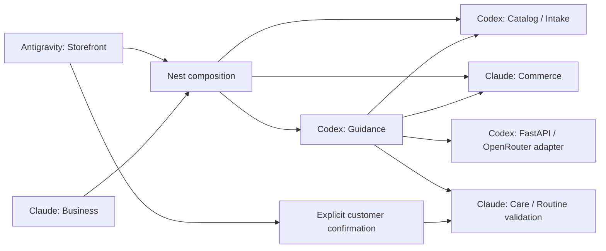
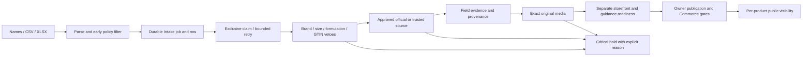
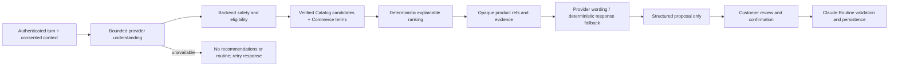
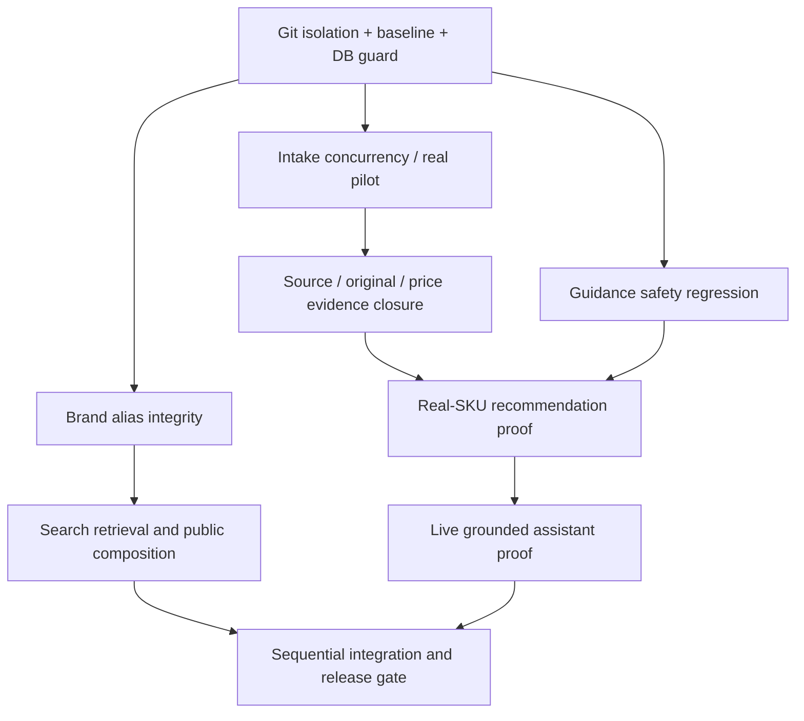

# Codex MVP execution — 15 November 2026

Base: `main` at `5f7487ac3b2570fb1919e1f8c64ef980214d29e3`. Deadline: 21 November. This is an evidence ledger, not a release approval.

## Reality and ownership

| Issue | Initial status | Repository evidence and remaining requirement |
|---|---|---|
| GLO-292 | PARTIAL | Dedicated `codex/astra-mvp-20261115` worktree from main. Claude worktrees exist; no Antigravity worktree is identifiable from Git. Main had untracked `.claude/worktrees/`, Business cache and web ESLint file; preserve all. `origin/main` was one local commit behind, remote not fetched. |
| GLO-293 | PARTIAL | `AdminIntakeService`, `IntakeStoreService`, canonical research, identity gates and durable retry closure exist. Prior retained pilot has real persisted evidence, not 10/10 commercial approval. Concurrent submission and claim races require regression proof. Current intake explicitly creates drafts; publication/Commerce remain separate owners. |
| GLO-294 | PARTIAL | Exact variant image binding, decoded-image controls, authentic-original fallback and explicit native-label review exist. Prior evidence still has blocked originals/formula cases and slow optional BiRefNet. Do not substitute images or weaken source restrictions. |
| GLO-299 | PARTIAL | `PostgresSearchProvider` uses normalized LIKE, public composition filters published products. Typo tolerance, mixed token matching, Egyptian aliases and sorting are not fully implemented. A second literal filter in composition would discard richer provider matches. |
| GLO-300 | PARTIAL | Brand research/provenance, Brand/ProductLine CRUD exist. Refreshing a brand profile replaces top-level reviewed aliases with nested research values that consumers do not read. Preserve manual aliases and expose only supported research aliases. |
| GLO-302 | PARTIAL | Deterministic eligibility/ranking, source labels, current Commerce terms and exclusions exist. Manufacturer contraindication UNKNOWN currently passes; needs tri-state gate. |
| GLO-301 | PARTIAL | Nest consultation + FastAPI OpenRouter gateway, versioned payload, usage limits, model policy and safe opaque refs exist. Understanding failure currently supplies empty red flags and still recommends; fail closed. Live provider-backed proof outstanding. |
| GLO-305 | PARTIAL | Auth/ownership, safe fetch/upload and negative suites exist. Prior full API run was red (104 failed tests), not a release gate pass. Fresh relevant negative checks and baseline comparison required. |

Previous evidence: `output/catalog-autopilot-2026-11-14/README.md` and `output/catalog-commerce-closure-2026-11-14/README.md`. These are historical retained-local-test results, not current production verification. They supersede the older 13 November cohort snapshot. Never combine cohort denominators or label DEV prices commercially approved.

Codex owns Catalog/Intake orchestration, media, search/brand, Guidance and AI provider integration. Claude owns Care/Routine persistence, Commerce/operations and deployment. Antigravity owns storefront consumers/UI. No shared Prisma migration, Care mutation, frontend change or new infrastructure in the first slices. External agent availability and Antigravity worktree identity are not proven.

## System and data flows

## Contract ledger

Reuse existing types; additive compatibility only. Do not fork these contracts into a new shared package.

| Contract and code owner | Validation / errors / permission | Consumers and compatibility |
|---|---|---|
| Catalog `public.ts`; `CatalogSnapshotService`, `CatalogService`, enrichment readiness | Identity/source/variant gates; unknown optional facts distinct from critical hold; public reads published only; mutations admin-owned | Intake, composition, Guidance; preserve existing SKU IDs and readiness fields |
| `SearchProvider.search(...): Promise<string[]>` / `SearchFilters`; Brand service DTOs | Bounded validated queries, active SKU/published-product filtering, normal empty result; admin writes | Storefront discovery; preserve the product-ID result contract and current public response |

16 November Search contract addition: `SearchFilters.visibility?: { productIds: string[]; skuIds: string[] }` is an internal composition-to-Catalog batch recheck, never a public query parameter. It applies the same reviewed alias/typo matching after Commerce/media/availability gates, so hidden-variant text cannot expose a product. `DiscoveryQueryDto.sort` is optional and typed as `relevance | name-asc | price-asc | price-desc`; facets/totals remain product-grouped after eligibility. Price sorting reads the minimum visible Commerce amount, changes no prices, and binds the cursor to sort/filter context. Suggestions retain their existing response type.
| `RecommendationInput`, `RecommendationRun`, `RecommendedItem` in Guidance recommendation service | Verified facts, current Commerce terms, safety exclusions and `needsSafetyAnswer`; no-match explicit | Storefront, consultation, routine proposals; deterministic ordering and exact SKU IDs |
| `ConsultContext`, `ConsultUnderstandResult`, `ConsultRespondResult` in `platform/ai`; `ConsultPayload` version 1 | Provider schema validation; session ownership, quotas/timeouts, filtered refs; FALLBACK explicit; no cart/order mutation | FastAPI `contracts/consult.py`, Storefront care-intelligence client; preserve payload version |
| `ConsultRoutineStep` and `ConsultPayload.routine`; Care public compatibility contract | Proposal is advisory; `canSave` reflects backend assessment; explicit customer confirmation and owner validation on save | Claude Care persistence and Antigravity review/edit/confirm UI; no duplicate Routine engine |

The shared Prisma schema and migrations require sequential coordination with Claude. Existing first-slice corrections need no migration. Saved Care safety schema has consent version/time; purpose/revocation semantics need the Care owner contract, not an inferred new field. Provider prose is less strongly constrained than typed product refs: semantic grounding remains a release risk until exercised.

## Decisions and dependency order

- Keep the modular monolith and current PostgreSQL, provider interfaces and local test tooling. No vector DB, queue, speculative adapter framework or duplicate model.
- Unknown evidence never becomes a positive fact. Manufacturer contraindications require a known answer; failed message understanding cannot establish safety.
- Optional media enhancement never gates a valid original. Commercial publication still requires owner-approved pricing and actual Commerce orderability; market references never create selling prices.
- Preserve reviewed brand aliases through research refresh. Unverified extracted aliases do not become identity matching evidence.

## Ordered implementation plan

| Day | Required outcome |
|---|---|
| Nov 15 | Reality/ownership/contracts; first failing regressions, corrections and isolated persisted proof; integrate verified slices |
| Nov 16 | Genuine catalog pilot; permitted exact sources/media and approved commercial policy; publish only eligible products |
| Nov 17 | Search/Brand gaps and typed consumer handoff; quantify precision/latency and expose unknowns |
| Nov 18 | Traceable real-SKU recommendations, live bounded OpenRouter proof, shared Routine proposal handoff |
| Nov 19 | Provider failure/privacy/injection/ownership regressions and cross-agent integration |
| Nov 20 | Integrated E2E and remaining P0/P1 regression; staging assistance only in authorized scope |
| Nov 21 | Current-main proof, unresolved release blockers and concise coordinator-ready issue updates |

Dates order dependencies, not scheduled unattended execution. Unblocked work proceeds now. The isolated 100-product development cohort below measures an explicit denominator; it is not a blind holdout or whole-market estimate.

## Verification and integration protocol

Both datasource URLs must be identical, localhost PostgreSQL and end in `_test`. Use a newly created task database; never reset a retained pilot or shared database. Tests isolate live providers. Full suites and focused proof have separate counts. Preserve logs, identify baseline failures and do not weaken assertions to turn a run green.

Commit explicit owned paths only after focused tests, negative checks, typecheck/lint/build as applicable. Before each main fast-forward inspect current HEAD/status, ancestry and overlap. If main advances, integrate in the isolated branch, revalidate affected contracts and then fast-forward main. No push or production deployment in this task without explicit authority. Refresh graph if runtime permits; current graphify launcher points to a missing Python interpreter.

## Risks / decisions requiring external evidence

- Cohorts differ. The older CeraVe five-hold report must not be combined with the Egyptian ten-product pilot restored and verified below.
- The owner clarified pricing: reuse GLO-280, Commerce and Admin Settings; exact Egyptian regular-retail evidence, preferably two independent credible sellers; keep reference, selling price and actual acquisition cost separate. Profitability belongs to the whole order, with packaging, delivery and direct costs. Numeric automatic-price thresholds/exceptions remain unapproved. Evidence collection continues; automatic commercial price activation stays disabled. Never change confirmed order prices.
- Live provider credentials/configuration and healthy services are necessary for provider-backed proof; never print or commit credentials.
- Existing API full-suite failures include relevant Catalog/Commerce/security paths. A successful focused slice is not the whole MVP DONE.
- External concurrent edits may advance main. Recheck ownership and ancestry at integration; do not overwrite or blanket-stage work.

## Execution evidence

### Integrated vertical slices

| Commit | Issues / concrete change | Fresh evidence | Integration |
|---|---|---|---|
| `0ae59ac` | GLO-300: preserve Admin aliases and verified research provenance across profile refresh, public Brand reads and intake snapshots | Three alias regressions; included in first focused run | Integrated |
| `2522dbc` | GLO-301/302/305: no recommendation or routine advice after failed safety understanding; unknown manufacturer contraindications require an answer | Outage/new-disclosure and safety regressions | Integrated |
| `0ebca2f` | GLO-293/305: concurrent submission replays, supplier-scoped checksum and due-row claim predicate | Five real PostgreSQL concurrency/scope cases | Integrated |
| `c81b0cb` | Merge current main `22b6926`; preserve Claude streaming, cancellation and action-reference validation | 35 streaming/consultation tests; API typecheck/build exit 0 | Main fast-forward |
| `6b9ada0` | GLO-294: only expand srcsets for an already product-bound asset; block same-folder campaign/other-product images, including stale proposals at import | Red regression; 46 tests on integrated main; typecheck/lint/build exit 0 | Main fast-forward |
| `5153d85` | GLO-293/305: distinct native variant names veto supplier matching; Admin canonical reuse requires exact native wording or a validated hard identifier; packs cannot reuse another pack or collide on SKU code | Three failures reproduced on baseline; 54 focused tests including database paths; typecheck/lint/build exit 0 | Main fast-forward |
| `236cf49` | GLO-293/300: carry approved/curated brand aliases into source revalidation; verify brand-bound Capixy manufacturer shop | 60 source/alias tests plus 21 owner/database tests; typecheck exit 0 | Main fast-forward |
| `cde4623` | GLO-293: recognize explicit ampoule/vial pack counts separately from per-unit volume | Four red regressions, then 46 focused tests including real intake | Main fast-forward |
| `4cef4e2` | GLO-293/305: hold conflicting approved barcodes even when native wording/page/size agree | Two valid-GTIN red regressions; 48 focused tests | Main fast-forward |
| `9326e94` | GLO-293/305: bounded bilingual source equivalence; reject unconfirmed strengths and named formulation conflicts | 55 focused tests, publication/boundary 13 tests; typecheck/lint/build exit 0 | Main fast-forward |
| `021fb29` | GLO-293/294: confirm explicit litre units/Arabic digits; retain smaller native renditions of an exact bound asset | Five red regressions; corrected canonical-unit assertion, 51 focused tests; typecheck/lint/build exit 0 | Main fast-forward |

Original-root work was preserved. An accidental fast-forward of the externally selected `feat/ask-shina-redesign` branch was corrected with only the exact owned paths and a checked ref update; its original HEAD and unrelated dirty changes were retained. Actual `main` integration uses a separate clean checkout. No push, production deployment or shared-database mutation occurred.

### Real ten-product pilot

- Source: retained `pilot02-starting-catalog-v4.dump`, job `be29142b-a331-4191-9d55-76750e0881f9`; restored into new `astra_pilot_restored_20261115_test`. Clean restore exit 0, pg_trgm prerequisite and latest migrations applied locally. The earlier partial restore was retained separately and excluded as proof.
- Ten native manufacturer pages fetched live on 15 November: ten identity matches and ten size confirmations. The StarVille page's mismatched lotion description is rejected; it is not used as cleanser guidance. Fresh owner research/automatic fact review was exercised locally. A replay with no new proposals can currently report `NO_EVIDENCE` despite successfully rereading existing facts; do not interpret that as a failed source fetch.
- All ten original image files were reacquired through `fetchSourceImage` from current exact product evidence. Every recovered file matches the retained asset SHA-256; originals and reviews were not replaced. Native-image contact sheet was inspected. All ten primary-image HTTP reads and all ten public product-detail reads succeeded. Five actual remote Cloudinary packaging-proof reads returned 200.
- The retained snapshot's ten optional editorial files are absent from the available storage archives (404). Native originals are valid; the complete retained gallery is **not** verified. Do not fabricate replacements or call this a clean visual launch pass. Snapshot backups need their media bytes, not only PostgreSQL.
- Intake readiness: ten PDP-ready records; seven with both chatbot/routine readiness. Bobai Oil Defense and the two Eva serums lack required verified composition/claims for advice. These record flags do not waive missing gallery bytes or commercial approval.
- Live market research ran for all ten against bounded current Egyptian retailer discovery. Zero corroborated regular-price references were ready; observations, rejected promotions/list prices and coverage reasons were retained. Selling-price rows remained byte-for-byte unchanged. Retained historical DEV prices are not commercial approval or actual acquisition costs.
- Idempotent replay: zero rows reprocessed; Product/SKU/fact/media/price counts unchanged at the measured replay.

### Representative evaluation

`apps/api/scripts/data/catalog-evaluation-20261115/` records 100 real manufacturer identities, exact input spellings, expected name/size/pack, public source URLs/timestamps/hashes, policy version 23, scope results and complete discovery/exclusion ledger. Unverified barcodes remain null. Source selection is deterministic by URL hash and brand/type strata, without a pipeline-success filter. Promotional duplicate titles and out-of-scope baby feeding/diaper products do not pad the count.

The expanded v2 batch has six of nine explicit allowlist brands, 13 type strata, 34 physical size/unit combinations, one known multipack, 22 Arabic inputs, 28 mixed inputs and 50 English inputs. Arabic spellings are labelled operator-authored inputs, not manufacturer translations or new facts. Eva remains 51/100; this is a documented manufacturer-source cohort, not a prevalence estimate for the entire Egyptian market or all allowlist brands.

Initial five-brand English/mixed run exposed the real Refresh/Hydrate false merge. After `5153d85`, a fresh database produced 35 distinct correct identities and 65 brand holds; no publication/pricing. Expanding the same methodology to native Arabic names and Capixy reduced verified coverage to 19/100 (19/19 literal identities correct), with 81 explicit holds. This lower result triggered source/alias repair; do not substitute the easier cohort's denominator.

The v2 pre-repair run took 92.008 seconds, with 43 page fetches, 31 image fetches, no paid discovery or LLM calls, 16 technical PDP-ready records, 11 guidance-ready records and zero commercially eligible/published/priced products. At least 84 rows need review (81 unresolved plus three additional PDP/critical holds). Monetary infrastructure cost was not metered and stays unknown. A stricter manufacturer-title oracle includes formulation words and pack count; brand/size alone is never reported as precision.

After alias/source/pack repair, an exploratory v2 run produced 78 identified identities, all 78 matching the literal manufacturer oracle, and 22 `NO_IDENTITY_SOURCE` holds. It took 437.387 seconds, with 100 page/199 image fetches, 71 technical PDP-ready records, 11 guidance-ready records, at least 29 review rows and zero prices/publication. A source line changed while that process was active, so this is worktree evidence, not a fixed-commit benchmark. Do not promote it to final integrated proof.

The public reproducibility package includes a source-binding audit (100/100 recorded manufacturer HTML hashes and primary Product/title/URL bindings), approved policy/BrandDraft alias snapshots, guarded real-owner pipeline CLI and independent literal oracle. Source code must be committed before a fixed-code run; the runner records HEAD/file hashes, rejects cross-code resumes and detects changes during execution. Remaining source/GTIN/formula audits and critical holds stay explicit; source binding alone is not publication approval.

### Verification and release boundary

- First focused slice: 15 suites / 133 tests pass, exit 0. Changed-path lint retained four pre-existing findings; no claim of repository-wide clean lint.
- Full baseline at `22b6926`: 142 suites pass / 31 fail; 1141 tests pass / 130 fail; zero skipped; exit 1.
- First full candidate at `c81b0cb`: 142 suites pass / 33 fail; 1149 pass / 134 fail. Four additional observed failures (three explicit PostgreSQL connection refusals, one RFQ shortfall assertion) all passed on a fresh focused seven-test rerun. They were not silently removed from the full result.
- Full integrated main at `5153d85`: 149 suites pass / 27 fail; 1190 tests pass / 101 fail; zero skipped; 384.126 seconds; exit 1. Failure-name comparison found no added failures against the baseline. Twenty-nine previously failing cases passed in this run; that observation does not prove these fixes caused their recovery. The release gate remains **RED**.
- `graphify update .` attempted: exit 103, launcher refers to missing Administrator Python 3.14. No environment reinstall or graph success claimed.

Logs, restored storage, native contact sheet and full runtime evidence are retained under the isolated worktree's `.codex/qa-logs/`; public reproducibility inputs and concise results are committed separately. Backend Search now has the continuation proof below. Full cross-agent UI verification, complete 100-product coverage and production release remain open.

## 16 November continuation

- `68f1e4d` integrated the guarded 100-SKU reproduction package; `6779e50` subsequently rejects incomplete evaluation summaries, exits 2 for durable pending retries, and records attempt usage. Four completion cases plus five literal oracle cases pass. The original fixed-code live run at `68f1e4d` observed 100 pending retries, not completed identities; its former `finishedAt` label is invalid and no success KPI is taken from it. A later in-app transport probe returned HTTP 429; the manufacturer still returned 429 with `Retry-After: 60` at `2026-11-16T00:02:04.957Z`. Robots were readable. No rate-limit workaround or publication was attempted.
- Full integrated API at `68f1e4d`: exit 1; 148 suites pass / 30 fail, 1211 tests pass / 104 fail, zero skipped. Compared with `22b6926`, two added failures were observed. The identity publication gate logged a local PostgreSQL connection refusal; its isolated rerun passed. The regular-price test rejected the wrong product correctly but received a less specific reason; `d475859` preserves `PAGE_TITLE_DIFFERS` while retaining the identity refusal. Its owner HTTP/unit tests pass. The full-run failure record remains intact; no whole-suite PASS is claimed.
- Search now includes reviewed Admin/profile/curated brand spellings, bounded Egyptian care-word aliases, mixed-field tokens, pg_trgm word similarity and a single adjacent-letter transposition. Approximate matching is excluded from code/barcode and numeric terms. Exact SKU codes/barcodes rank first; all SKU-dependent terms must match the same active variant. Composition rechecks only visible variant IDs in batches instead of applying a conflicting literal filter. Grouping, published filtering, facets and owner-controlled sellability remain in place.
- A new isolated-only migration aligns NFKC, Arabic/Persian digit, letter and format-mark normalization, then rebuilds the eight affected function indexes. No shared migration was applied. Source normalization and index SQL are based on the PostgreSQL [string function](https://www.postgresql.org/docs/17/functions-string.html) and [pg_trgm](https://www.postgresql.org/docs/17/pgtrgm.html) contracts. Deployment needs the normal owner migration rollout; this ledger does not authorize it.
- Search tests first reproduced ten failures, then additional visibility, sorting and exact-SKU-ranking regressions. Current focused run: 46 pass / one local DB connection-initialization failure; that one-case identity gate passed alone afterward. Typecheck, changed-path lint and API build exit 0. Real SQL tests cover reviewed/unverified aliases, Arabic/mixed text, typos, wildcards/injection, inactive/unpublished identities, line filters, visible-SKU rechecks and normalization parity. Production-scale latency, native UI integration and a blind search relevance benchmark remain unverified.

### Completed continuation evidence

- `76636f8`: an existing canonical SKU's known primary/approved alias set now vetoes a conflicting native GTIN before any formula/image/description enrichment. Only the contradiction is retained as a fact-review hold; it cannot be reintroduced as ingredient evidence through a provider reading of the same URL, including fragments. Approved aliases and zero padding do not overwrite the primary barcode; retired aliases authorize nothing. Valid-fixture red regressions and a provider-fragment regression were reproduced, followed by seven suites / 64 tests passing. The extractor is schema 6.
- The same commit respects HTTP 429 Retry-After seconds/date values with a host cooldown, no immediate second request and an explicit retry deadline. Unknown or rate-limited robots remain unknown; recovered disallow rules still block access. Four red cases then 47 fetch/transport/security cases passed. This is a process-level cooldown, not a claim of a distributed rate limiter.
- Main at `8800760`: fourteen focused API suites / 111 tests pass on a fresh disposable migrated database. Full API: exit 1, 152 suites pass / 29 fail, 1243 tests pass / 103 fail, zero skipped, 513.054 seconds. Baseline-name comparison leaves one additional observed failure, the publication identity gate's 500; the full log records database connectivity failure, while that gate passes in focused runs. The full release gate remains RED.
- Fixed-code v2 evaluation at `8800760` completed 100 row outcomes with unchanged source hashes/HEAD: two correct drafts, 98 `RETRY_EXHAUSTED`, two technical PDP-ready, zero guidance-ready, zero commercial-ready, zero publications/prices. Precision is 2/2 and coverage 2/100; this is not a general precision guarantee. Duration 1,921,655 ms includes durable backoff and gaps between CLI invocations, not production throughput. Counters record 497 page-fetcher invocations and 12 image invocations; monetary network/compute/storage cost is unknown. The 98 temporary-source failures require source recovery/retry, not fabricated labels. The earlier exploratory 78/100 observation is retained separately. `results/` records both boundaries and denominators.
- Current policy version 23, public Brand metadata and approved BrandDraft aliases were refreshed on 16 November in a READ ONLY transaction and were unchanged. The representative input remains 100 genuine distinct manufacturer SKUs. No shared database/catalog changes occurred.
- `8800760`: the AI service now returns a backend escalation response before any model call or streamed delta. Four adversarial Arabic/English streaming/nonstreaming cases failed before the fix. Offline AI suite then passed 109 tests with three opt-in live skips. The existing Nest consumer continues to source routine usage from the manufacturer's stored instructions and keeps Care/Routine persistence with its owner.
- `c4f5ee9` / `56fda12`: actual free-router probes exposed mandatory-reasoning HTTP 400 and a trickled, incomplete response taking 149 seconds despite a 50-second read timeout. The gateway leaves model-specific reasoning controls unset and enforces a wall-clock deadline for each complete-response attempt; retry count, free-only routing, privacy and production model policy are preserved. New failures were reproduced before fixes; the complete offline Python suite passes 111 tests, three live skips. No dependency was installed.
- At `229a837`, the last live response contract probe passed using `baidu/ernie-5.5-flash-preview:free`, 1,319 prompt / 982 completion tokens, reported cost USD 0, 7,399.8 ms provider latency, no paid fallback, data collection denied, and unchanged code. Two other live tests were deselected in this bounded follow-up. Earlier failed/partly successful probes remain retained; this is not sustained-provider-reliability or general semantic-grounding approval.
- Real restored ten-product pilot public HTTP search first exposed two missing L'Oréal Paris spellings (13/15). `229a837` adds retrieval-only spellings supported by the [manufacturer's Arabic identity](https://www.loreal-paris-me.com/ar/about-us), keeping intake identity aliases separate, and refuses cross-currency numeric price sorting. All 15 pilot queries then found their expected identities; invalid sort/private visibility inputs returned 400, visible price ordering was ascending, and Product/SKU/fact/media/price/publication counts were unchanged. Fifteen sequential local queries: median 47.75 ms, p95 163.81 ms, maximum 831.88 ms; this is a small local pilot, not a production SLO. Four focused Search/alias/boundary suites / 42 tests pass, with typecheck/lint/build exit 0.

Final boundary: Catalog/Intake, backend Search and AI safety slices are implemented and locally integrated. Full release acceptance remains PARTIAL: source availability severely limited the fixed 100 run; ten optional retained editorial bytes are absent; three pilot products lack verified guidance evidence; corroborated market references and numeric commercial activation approval remain unresolved; UI/Care-owner integration and broad failing API suites need separate closure. No push, deployment, pricing formula activation or claim of production readiness is made.
